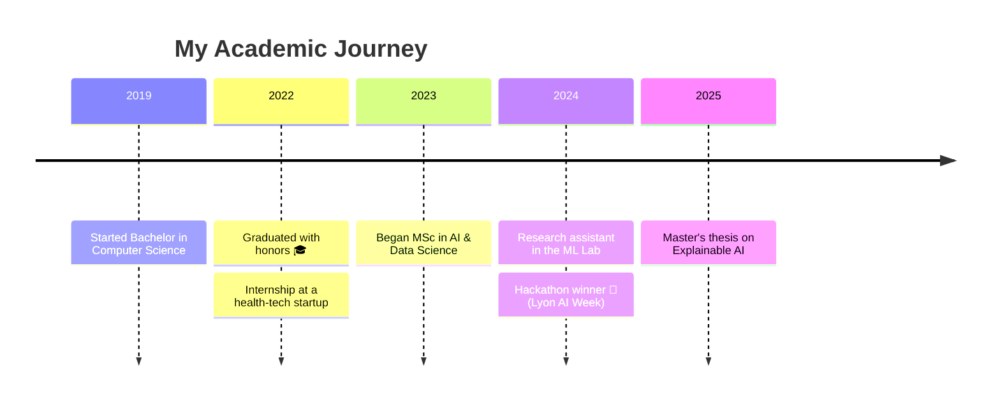

<!-- Replace every "USERNAME" with your real GitHub username so the stats cards work -->

<!-- ═══════════════ HEADER ═══════════════ -->


<div align="center">

[](https://git.io/typing-svg)


</div>

---

## 👩‍🎓 About Me

<table>
<tr>
<td width="60%">

```yaml
name:        Léa Moreau
status:      MSc 2nd year — AI & Data Science 🎓
university:  Université de Lumière (fictional)
location:    Lyon, France 🇫🇷
languages:   French 🇫🇷 · English 🇬🇧 · Spanish 🇪🇸
fun_fact:    I train neural nets while my coffee brews ☕
```

</td>
<td width="40%" align="center">


</td>
</tr>
</table>

- 🔭 Currently working on my **master's thesis**: *Explainable AI for medical image classification*
- 🌱 Learning **MLOps**, **Rust** and **Graph Neural Networks**
- 🤝 Looking to collaborate on **open-source ML projects**
- 💬 Ask me about **Python, data visualization, or surviving thesis season**
- ⚡ Fun fact: I once debugged a model for 6 hours… it was a typo in a CSV 🙃

---

## 🛠️ Tech Stack

<div align="center">

### 💻 Languages


### 🤖 AI / Data Science


### 🌐 Web & Tools


### ☁️ Cloud & Databases


</div>

### 📈 Skill Levels

| Skill                     | Level                                                                                      |
| ------------------------- | ------------------------------------------------------------------------------------------ |
| 🐍 **Python**             |  |
| 🔥 **PyTorch**            |  |
| 📊 **Data Visualization** |  |
| 🗄️ **SQL**                |  |
| 🐳 **Docker / MLOps**     |  |
| 🦀 **Rust**               |  |

---

## 🚀 Featured Projects

<table>
<tr>
<td width="50%" valign="top">

### 🩻 [MedScan-XAI](https://github.com/USERNAME)
Explainable deep learning for chest X-ray classification using Grad-CAM and SHAP.


</td>
<td width="50%" valign="top">

### 🌍 [ClimateLens](https://github.com/USERNAME)
Interactive dashboard visualizing 50 years of global temperature data.


</td>
</tr>
<tr>
<td width="50%" valign="top">

### 💬 [StudyBuddy-Bot](https://github.com/USERNAME)
An NLP chatbot that generates flashcards and quizzes from lecture notes.


</td>
<td width="50%" valign="top">

### 🕸️ [GraphWalker](https://github.com/USERNAME)
Experiments with Graph Neural Networks for recommendation systems.


</td>
</tr>
</table>

---

## 📊 GitHub Stats

<div align="center">


<br/>


<br/>


</div>

---

## 🏆 Achievements & Education



<div align="center">


</div>

---

## 📚 Currently Learning

<div align="center">


</div>

---

## 📫 Let's Connect

<div align="center">

<a href="https://linkedin.com/in/USERNAME"></a>
<a href="mailto:lea.moreau@example.com"></a>
<a href="https://kaggle.com/USERNAME"></a>
<a href="https://twitter.com/USERNAME"></a>
<a href="https://USERNAME.github.io"></a>

<br/><br/>

> 💡 *"Data is just a story waiting for someone to listen."*

<br/>


</div>

<!-- ═══════════════ FOOTER ═══════════════ -->

