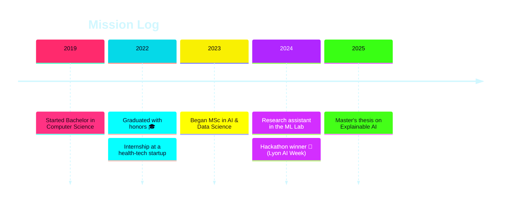

<!--
  CYBERPUNK PROFILE
  Upload the "assets" folder to the root of this repo (same level as README.md).
-->

<!-- ═══════════════ HEADER ═══════════════ -->


<div align="center">

[](https://git.io/typing-svg)


</div>


<!-- ═══════════════ ABOUT (pink) ═══════════════ -->


<table>
<tr>
<td width="60%">

```yaml
> whoami
name:        Léa Moreau
class:       Netrunner (MSc 2nd year) 🎓
academy:     Université de Lumière (fictional)
sector:      Lyon, France 🇫🇷
languages:   French 🇫🇷 · English 🇬🇧 · Spanish 🇪🇸
power_source: coffee ☕ (critical dependency)
```

</td>
<td width="40%" align="center">


</td>
</tr>
</table>

- 🔭 **Current mission:** master's thesis on *Explainable AI for medical image classification*
- 🌱 **Installing:** MLOps, Rust and Graph Neural Networks
- 🤝 **Seeking:** open-source ML crews to collaborate with
- 💬 **Ask me about:** Python, data visualization, or surviving thesis season
- ⚡ **Known bug:** once spent 6 hours debugging a model… it was a typo in a CSV 🙃


<!-- ═══════════════ TECH STACK (cyan) ═══════════════ -->


<div align="center">

+loading+modules...;>+languages+%7C+ai+%7C+web+%7C+cloud;>+all+systems+nominal" alt="Stack typing" />

### 💻 Languages


### 🤖 AI / Data Science


### 🌐 Web & Tools


### ☁️ Cloud & Databases


</div>

### ⚙️ Power Levels

| Skill                     | Level |
| ------------------------- | ----- |
| 🐍 **Python**             |  |
| 🔥 **PyTorch**            |  |
| 📊 **Data Visualization** |  |
| 🗄️ **SQL**                |  |
| 🐳 **Docker / MLOps**     |  |
| 🦀 **Rust**               |  |


<!-- ═══════════════ PROJECTS (yellow) ═══════════════ -->


<table>
<tr>
<td width="50%" valign="top">

### 🩻 [MedScan-XAI](https://github.com/kztcha)
Explainable deep learning for chest X-ray classification using Grad-CAM and SHAP.


</td>
<td width="50%" valign="top">

### 🌍 [ClimateLens](https://github.com/kztcha)
Interactive dashboard visualizing 50 years of global temperature data.


</td>
</tr>
<tr>
<td width="50%" valign="top">

### 💬 [StudyBuddy-Bot](https://github.com/kztcha)
An NLP chatbot that generates flashcards and quizzes from lecture notes.


</td>
<td width="50%" valign="top">

### 🕸️ [GraphWalker](https://github.com/kztcha)
Experiments with Graph Neural Networks for recommendation systems.


</td>
</tr>
</table>


<!-- ═══════════════ STATS (green) ═══════════════ -->


<div align="center">


<br/>


<br/>


<br/>

<!-- Animated contribution snake: needs the GitHub Action from snake.yml -->


</div>


<!-- ═══════════════ ACHIEVEMENTS (orange) ═══════════════ -->




<div align="center">


<br/>


</div>


<!-- ═══════════════ LEARNING (purple) ═══════════════ -->


<div align="center">

+reading+papers+on+Graph+Neural+Networks...;>+fine-tuning+my+first+LLM...;>+containerizing+everything+with+Docker...;>+fighting+the+Rust+borrow+checker+🦀" alt="Learning typing" />

<br/>


</div>


<!-- ═══════════════ CONTACT (blue) ═══════════════ -->


<div align="center">

<a href="https://linkedin.com/in/kztcha"></a>
<a href="mailto:lea.moreau@example.com"></a>
<a href="https://kaggle.com/kztcha"></a>
<a href="https://twitter.com/kztcha"></a>
<a href="https://kztcha.github.io"></a>

<br/><br/>

> 💡 *"Data is just a story waiting for someone to listen."*

</div>

<!-- ═══════════════ FOOTER ═══════════════ -->

